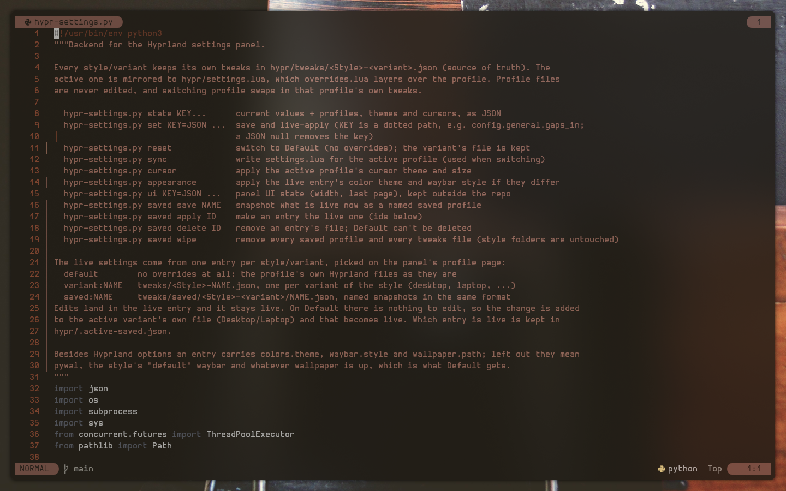
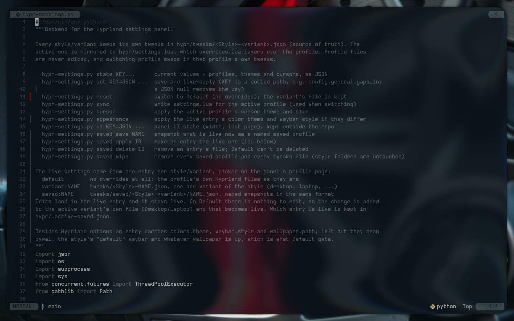
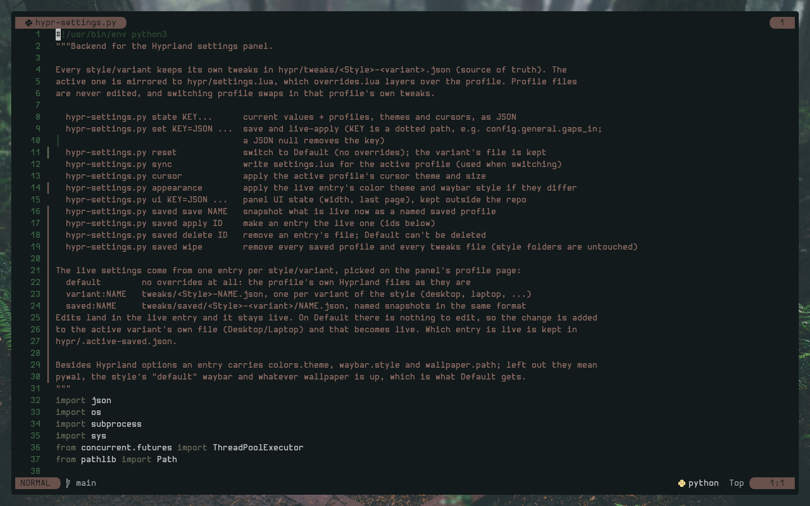
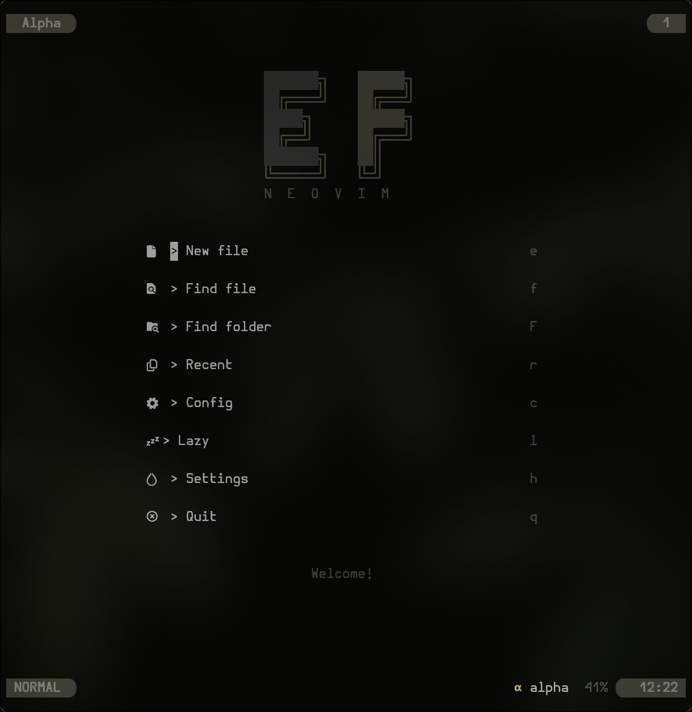
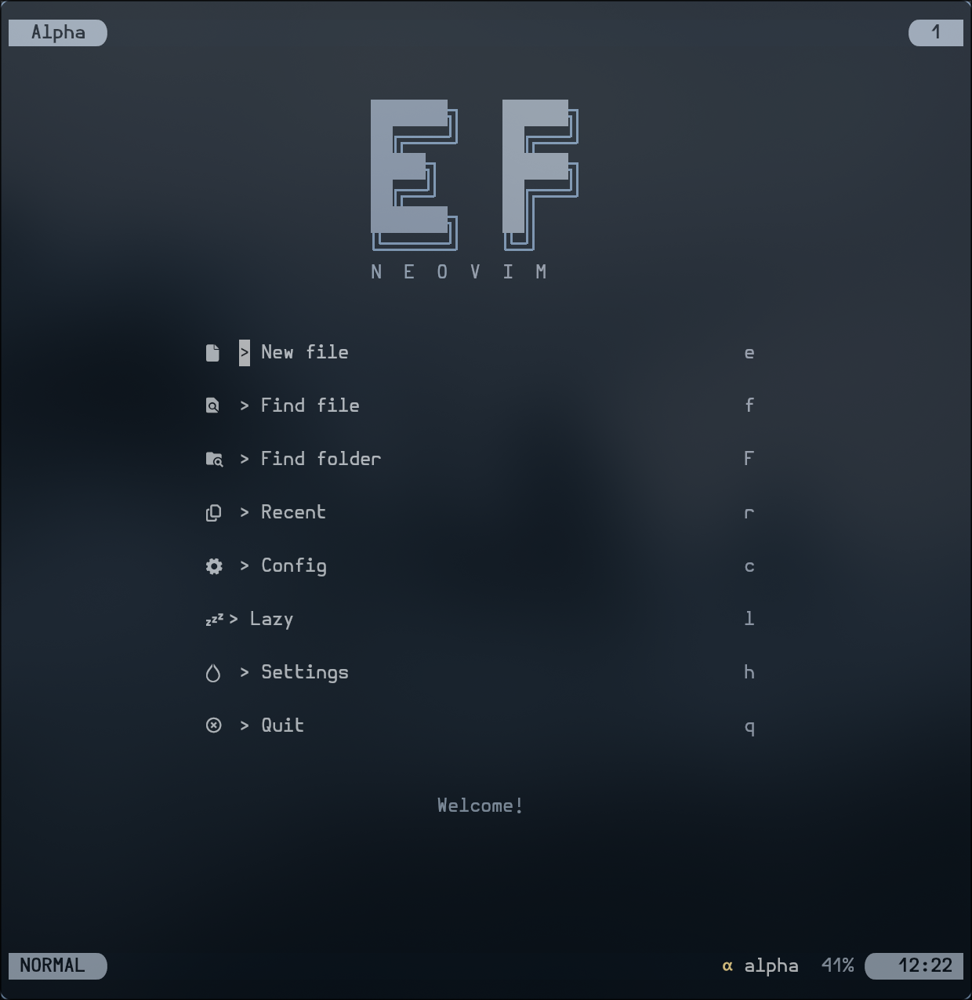
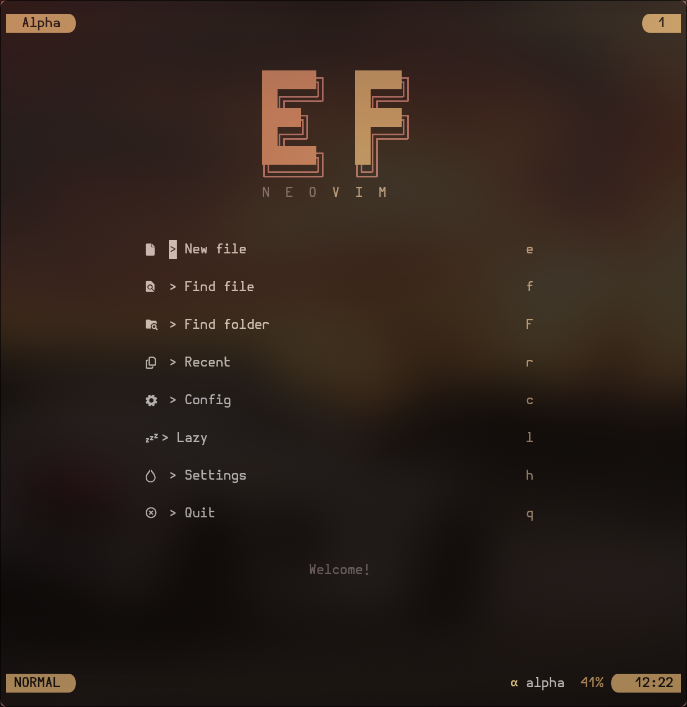

# MyNvim

My neovim config. pywal colors, lazy.nvim, and not much else in the way.

<p align="center">
  
  
  
</p>
<p align="center">
  
  
  
</p>

## Install

```sh
git clone https://github.com/elifouts/MyNvim ~/.config/nvim
nvim
```

Plugins install themselves on first launch.

## Needs

- neovim 0.10+
- a nerd font
- git, ripgrep
- [pywal16](https://github.com/eylles/pywal16) for the default colors, or switch with `:ThemeFileTokyo`, `:ThemeFileGruvbox`, `:ThemeFileNord`...

## What's in it

- **ui**: alpha dashboard, lualine, noice, which-key
- **files**: neo-tree, telescope
- **code**: lsp + mason, nvim-cmp, luasnip, treesitter, gitsigns
- **ai**: copilot, copilot chat
- **themes**: pywal, tokyonight, gruvbox, kanagawa, catppuccin, rose-pine, nord, everforest, onedark
- **extra**: markview, typr

Leader is `space`. Keybinds are in [KEYBINDS.md](KEYBINDS.md).

Part of my [Dotfiles](https://github.com/elifouts/Dotfiles).
